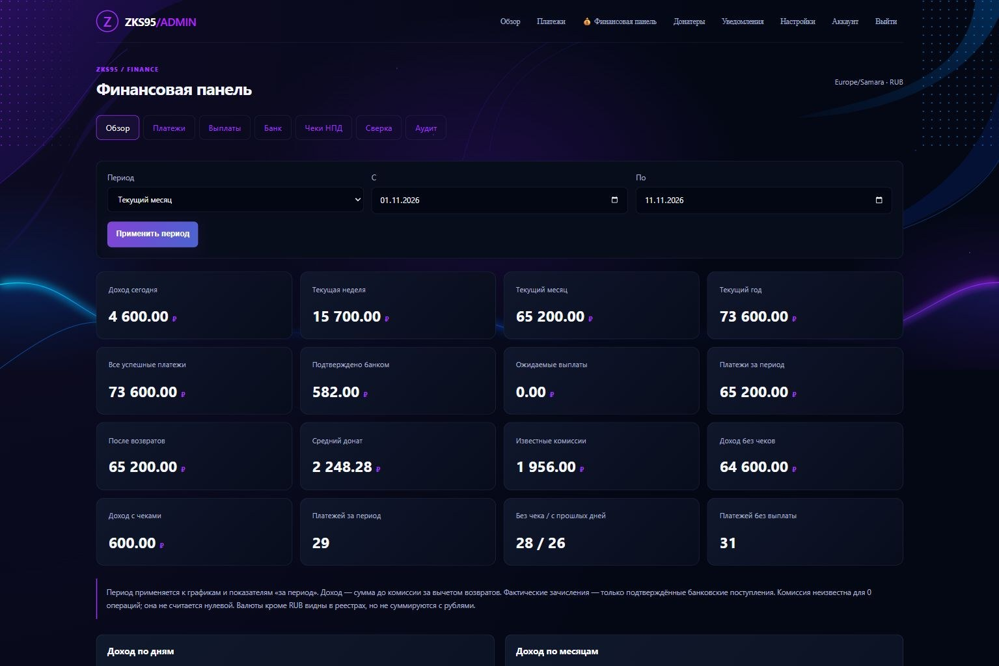

# Финансовая панель ZKS95

Раздел находится в существующей админке: `/admin/finance/`. Используются те же аккаунты, постоянные сессии, 2FA и CSRF. Публичных финансовых API нет. Доступны обе темы сайта, горизонтальная прокрутка таблиц и вкладок на смартфоне.

## Обновление и настройка

Для установленного сайта:

```bash
curl -fsSL "https://raw.githubusercontent.com/kzolotarev95/new-donat-zks95/main/vps/update-vps-2.sh?v=$(date +%s)" | sudo bash
```

Или непосредственно в установленном репозитории:

```bash
cd /opt/new-donat-zks95
sudo bash update.sh
```

Установщик и обновление устанавливают `openpyxl`, `defusedxml`, `tzdata`, миграцию и systemd-таймер. SQLite перед обновлением сохраняется через online backup API (`sqlite3 .backup`), вместе с WAL-данными. Обновление не заменяет пользовательскую базу. При откате кода добавленные финансовые таблицы остаются в базе и не мешают старой версии.

1. Откройте **💰 Финансовая панель → Обзор**.
2. В существующих **Настройках → YooKassa** должны быть заполнены Shop ID и секретный ключ вашего магазина. Новые ключи не нужны.
3. Раскройте **Настройки синхронизации и времени**. По умолчанию часовой пояс `Europe/Samara`, начало запрашиваемой истории `2020-01-01`, автоматическая синхронизация выключена.
4. Выберите дату начала и свой часовой пояс IANA. Доступную глубину истории ограничивает ЮKassa; локальные старые записи сохраняются.
5. Нажмите **Синхронизировать в фоне**. Очередь обработает таймер, максимум через пять минут. Состояние и ошибка показываются в обзоре.
6. Для постоянного обновления включите автоматическую синхронизацию и сохраните настройки. Параметры `FINANCE_TIMEZONE`, `FINANCE_SYNC_FROM`, `FINANCE_SYNC_ENABLED` хранятся в SQLite и входят в полный бэкап.

Команды администратора VPS:

```bash
# Проверка фонового таймера и последнего запуска
sudo systemctl status new-donat-zks95-finance.timer --no-pager
sudo systemctl status new-donat-zks95-finance.service --no-pager
sudo journalctl -u new-donat-zks95-finance.service -n 50 --no-pager

# Обработать уже поставленную через админку задачу немедленно
sudo systemctl start new-donat-zks95-finance.service
```

Запуск сервиса при выключенной автоматике и пустой очереди завершается без обращения к ЮKassa. Удаление проекта останавливает только его финансовые units и сохраняет SQLite вместе со всем финансовым реестром.

## Что считается доходом и выплатой

Деньги хранятся целыми копейками, входящие значения проверяются через Decimal. Рубли не складываются с другими валютами. Рублёвый обзор показывает доходы на дату подтверждения платежа, либо дату создания, если в исторической записи нет даты подтверждения. Границы дней определяет выбранный часовой пояс.

- Успешный платёж — запись ЮKassa со статусом `succeeded`. Валовая сумма и возврат показываются отдельно.
- Платёж с признаком `test=true` помечается в таблице, но не включается в реальные доходы, сверку выплат или реестр чеков.
- Доход после возвратов / расчётная база — валовая сумма минус подтверждённые возвраты, до комиссии. Это вспомогательный реестр для проверки владельцем.
- Комиссия — разница `amount - income_amount`, когда ЮKassa возвращает оба значения в одной валюте, либо ручное подтверждённое значение из документа. Отсутствующая комиссия отображается прочерком и отдельным счётчиком.
- Ожидаемая выплата — запись из отчёта, введённая владельцем. Она не считается банковским зачислением.
- Подтверждённая выплата — выплата, которую владелец связал с банковской операцией, проверил и подтвердил. Суммы и валюты должны совпадать.
- Банковское зачисление выручки не создаёт второй доход поверх исходных платежей. Только явно классифицированное владельцем самостоятельное поступление попадает в реестр доходов банка.

Счётчики «сегодня / неделя / месяц / год» относятся к календарным периодам, «все успешные платежи» и банковские суммы — ко всей истории. Метрики с указанием периода, чеки и графики используют выбранный период. Исключение дохода из реестра чеков не скрывает реально полученные деньги из финансовой статистики.

Карточка задач с прошлых дней напоминает о доходах без отметки чека. Она не устанавливает юридический срок оформления. Полностью возвращённые платежи не создают ненулевую задачу. Статусы чеков и категорию дохода подтверждает владелец.

## Как работает синхронизация

Фоновый процесс выполняет только GET к официальному API: списки `/v3/payments`, `/v3/refunds`, проверку известных незавершённых объектов по ID. В интерфейсе нет создания возвратов, исходящих выплат или регистрации чеков в ФНС.

Первый цикл загружает доступную историю с выбранной даты, последующие — изменения с трёхдневным перекрытием. ID платежей и возвратов уникальны. Курсор и этап сохраняются после каждой страницы. Один запуск обрабатывает до 10 страниц по 100 объектов, затем продолжает в следующем запуске. До пяти старых незавершённых платежей и возвратов проверяются отдельно. Завершённые статусы не откатываются устаревшим ответом.

Сетевые тайм-ауты ограничены, между запросами выдерживается пауза. Ошибка не удаляет реестр: сохраняется безопасное сообщение и повтор назначается через пять минут. Lease не допускает одновременной работы двух синхронизаций. Сервис работает отдельным процессом с ограничением CPU, памяти и времени. При открытии страницы сетевых запросов к ЮKassa нет.

Существующий webhook по-прежнему подтверждает платежи, пополняет список донатеров и отправляет push. Зеркало в финансовом реестре обновляется в той же транзакции. Фоновая загрузка не создаёт повторных донатеров, платежей сайта или push.

## Выплаты и сверка

1. В **Выплатах** добавьте ID реестра / выплаты, ожидаемую дату, сумму к зачислению, известную комиссию и источник — например, номер отчёта ЮKassa.
2. В **Банке** загрузите выписку или добавьте фактическое поступление вручную. Запись из отчёта не заменяет выписку.
3. В **Сверке** свяжите успешные платежи с выплатой. Комиссии должны быть известны. Один платёж можно связать только с одной выплатой.
4. Сверка вычислит сумму платежей после комиссий и возвратов и покажет разницу с выплатой. Изменившийся возврат пересчитывает разницу, сохраняя исходную связь в аудите.
5. Кандидаты банковских операций подбираются по сумме и валюте. Проверьте дату, назначение и источник. В **Выплатах** укажите ID банковской операции, комментарий и подтвердите поступление галочкой.

Ошибочно отменённую выплату можно вернуть в статус «Ожидается» через **Восстановить выплату** в её карточке. ID и журнал сохраняются; банковское подтверждение и связи после отмены нужно проверить заново. Ожидаемая выплата редактируется через **Изменить данные выплаты**. Если платежи уже связаны, сначала уберите их связи в **Сверке**. Для исправления подтверждённой выплаты используйте отмену, восстановление, редактирование и повторное подтверждение. Физическое удаление не требуется. Все изменения записываются в аудит.

Если банковская операция ошибочно исключена, в **Банк → Изменить категорию** выберите **Не разобрано**, укажите причину и подтвердите. После этого её снова можно выбрать для выплаты.

Одна банковская операция может подтверждать только одну выплату. Отмена ошибочной записи выплаты освобождает связи, но сохраняет саму запись и историю. Платежи без выплаты, выплаты без платежей, неизвестные комиссии и ненулевая разница остаются видимыми. Частичные перечисления одного платежа в нескольких реестрах не распределяются автоматически: не скрывайте такое расхождение ручной подменой сумм.

## Банковские выписки и Сбербанк

Доступ к конкретному банковскому API зависит от продукта банка и разрешений владельца счёта. Без такого доступа используются реальные выписки и ручная сверка. `BankingProvider.operations(content)` — интерфейс для официального банковского адаптера; работающие реализации: CSV, XLSX и OFX. Логины банка, SMS-коды и сессионные токены не запрашиваются и не сохраняются.

В **Банке** доступны шаблон CSV, импорт файла и ручное поступление. Указывайте одинаковые источник и обозначение счёта при повторных импортах — они входят в ключ защиты от повторов. Достаточно внутреннего имени / последних цифр счёта.

```csv
date;amount;currency;id;description
2026-11-11;970.00;RUB;bank-operation-id;Зачисление по реестру ЮKassa
```

Поддерживаются UTF-8 / Windows-1251, разделители `;`, запятая или табуляция, даты ISO или `ДД.ММ.ГГГГ`, десятичная точка / запятая, распространённые русские заголовки: `Дата операции`, `Сумма`, `Валюта`, `Номер операции`, `Назначение платежа`. XLSX: первая строка — заголовки активного листа. OFX: `STMTTRN`, `DTPOSTED`, `TRNAMT`, `FITID`, `MEMO/NAME`, `CURDEF`.

Если банк выгрузил другой набор колонок, приведите его к шаблону; неподдерживаемая структура отклоняется, суммы не угадываются. Учитываются положительные входящие операции; нулевые и отрицательные строки пропускаются. Лимит — 5 МБ и 10 000 строк; распакованный XLSX — 30 МБ, 100 столбцов. Файл не исполняется и не хранится после разбора.

Повтор файла или операции не добавляет запись. Если тот же банковский ID появился с другой суммой, валютой или датой, весь новый импорт откатывается с ошибкой. При отсутствии ID используется отпечаток даты, суммы, валюты и назначения — сохраняйте стабильное описание. Классификацию самостоятельного дохода подтверждайте только после проверки отсутствия его среди платежей ЮKassa.

## Мой налог / ручной контроль чеков

1. В **Чеках НПД** выберите доход, проверьте источник, сумму, комиссию и расчётную базу.
2. Оформите / проверьте чек в официальном «Мой налог» самостоятельно.
3. Укажите категорию покупателя, номер, дату и при наличии HTTPS-ссылку на чек.
4. Выберите **Чек оформлен** или **Проверен**, поставьте галочку подтверждения и сохраните.
5. При возврате / исключении укажите основание в комментарии. Финансовый возврат принимается из ЮKassa, а не из ручной отметки статуса чека.

Есть фильтры, поиск, ссылка на чек и история изменений. Каждое изменение сохраняет администратора, время, старые и новые значения. Панель не обращается к неофициальным API ФНС и не использует устаревший сервис чеков самозанятых ЮKassa. Статус «оформлен» означает подтверждение владельца, а не автоматическую регистрацию панелью.

## Миграция и резервные копии

Фактическая миграция: [`app/finance/schema.py`](../app/finance/schema.py), версия `finance_meta.schema_1`. Используется `CREATE TABLE/INDEX IF NOT EXISTS`; действующие таблицы платежей, донатеров и аккаунтов не заменяются. При первом запуске существующие платежи однократно копируются в финансовое зеркало. Повторный запуск не дублирует записи.

| Таблица | Назначение / ключ |
|---|---|
| finance_meta | Версия миграции |
| finance_transactions | Платежи, уникальный payment_id, суммы в копейках |
| finance_refunds | Возвраты, уникальный refund_id |
| finance_bank_imports | Журнал импортов, уникальный digest |
| finance_bank_operations | Поступления, уникальный fingerprint |
| finance_payouts | Выплаты, уникальные external_id и bank_id |
| finance_reconciliation | Связи платёж → выплата, уникальный payment_id |
| finance_receipts | Ручной статус чека для уникального income_key |
| finance_audit_log | История ручных финансовых действий |
| finance_sync | Очередь, курсор, lease, безопасная ошибка |
| finance_cache | Агрегаты с TTL 30 секунд |

Индексы покрывают даты платежей, статусы, даты банка, выплаты, связи и аудит. Изменения данных инвалидируют кэш. Полный JSON-бэкап из **Настроек → Бэкап** содержит финансовый реестр, связи, чеки, аудит и настройки; очередь/lease/кэш не переносятся. Экспорт читает согласованный снимок SQLite. Восстановление транзакционное: некорректный архив не заменяет текущие данные. Во время активной синхронизации восстановление блокируется до её завершения. Старые архивы без финансовых таблиц поддерживаются — зеркало строится из сохранённых платежей.

## Внутренние endpoints

Все пути начинаются с `/admin/finance`; все требуют существующей авторизации администратора. POST требует действующий CSRF-токен. GET-ответы не кэшируются браузером.

| Метод | Путь | Назначение |
|---|---|---|
| GET | `/`, `/api/summary` | Сводка HTML / JSON, фильтр периода |
| GET | `/payments` | Поиск, даты, статус, суммы, донатер, сортировка, 15 записей |
| GET | `/payments/<payment_id>` | Детали и возвраты |
| POST | `/payments/<payment_id>/fee` | Подтверждённая комиссия с источником и аудитом |
| GET / POST | `/payouts` | Список / добавить запись из отчёта |
| POST | `/payouts/<id>/edit`, `/restore` | Изменить ожидаемую / восстановить отменённую выплату с аудитом |
| POST | `/payouts/<id>/confirm` | Подтвердить банковское поступление |
| POST | `/payouts/<id>/link`, `/unlink`, `/cancel` | Связать платёж, убрать связь, отменить запись |
| GET | `/bank`, `/bank/template.csv` | Банк и шаблон |
| POST | `/bank/import`, `/bank/manual` | Выписка / ручное поступление |
| POST | `/bank/<id>/classify` | Классификация с подтверждением и комментарием |
| GET | `/receipts`, `/receipts/<income_key>` | Реестр чеков / детали и история |
| POST | `/receipts/<income_key>` | Подтвердить ручное изменение |
| GET | `/reconciliation`, `/audit` | Сверка и аудит |
| POST | `/sync`, `/settings` | Поставить задачу / настройки синхронизации |

## Файлы и проверка

- Backend: `app/finance/{__init__,schema,ledger,analytics,banking,operations,sync}.py`.
- Интеграция: `app/admin.py`, `app/db.py`, `app/backup.py`, `templates/admin/base.html`.
- Интерфейс: `templates/admin/finance/*.html`, `static/css/finance.css`, `static/js/finance.js`.
- Runtime: `scripts/sync_finance.py`, `config/systemd/new-donat-zks95-finance.{service,timer}`, `requirements.txt`, `install.sh`, `update.sh`, `uninstall.sh`.
- Проверки: `tests/test_finance.py`; полный запуск `python -m pytest -q` и существующий GitHub Actions CI.

Тесты проверяют копейки, миграцию и зеркало webhook, отсутствие двойного дохода, сверку, изменение суммы после возврата, подтверждение чеков, аудит, три формата выписок, повторы и конфликт ID, частичную синхронизацию, старые незавершённые операции, недоступность API, атомарный бэкап, CSRF, закрытый доступ, фильтры и пагинацию. Локальная визуальная проверка выполняется на вымышленных данных, без создания реальных платежей или чеков.

Вид на ПК и смартфоне, **вымышленные данные локальной проверки**:



[Мобильный вид](screenshots/finance-mobile.jpg).

Официальные источники, проверенные при реализации: [API платежей и возвратов ЮKassa](https://yookassa.ru/developers/api#get_payments_list), [объект платежа и income_amount](https://yookassa.ru/developers/api#payment_object), [назначение API исходящих выплат](https://yookassa.ru/developers/api#payout_object).
