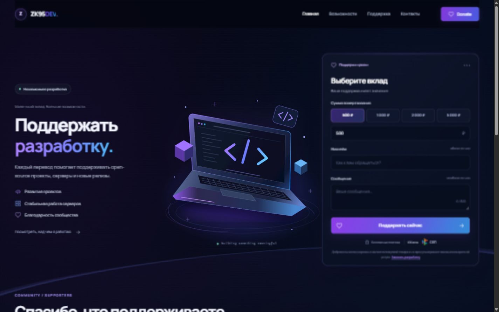
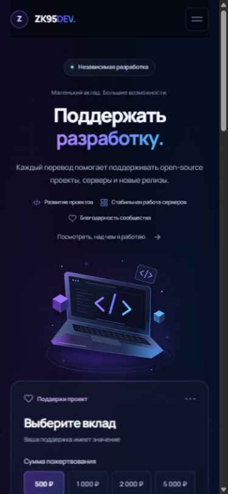
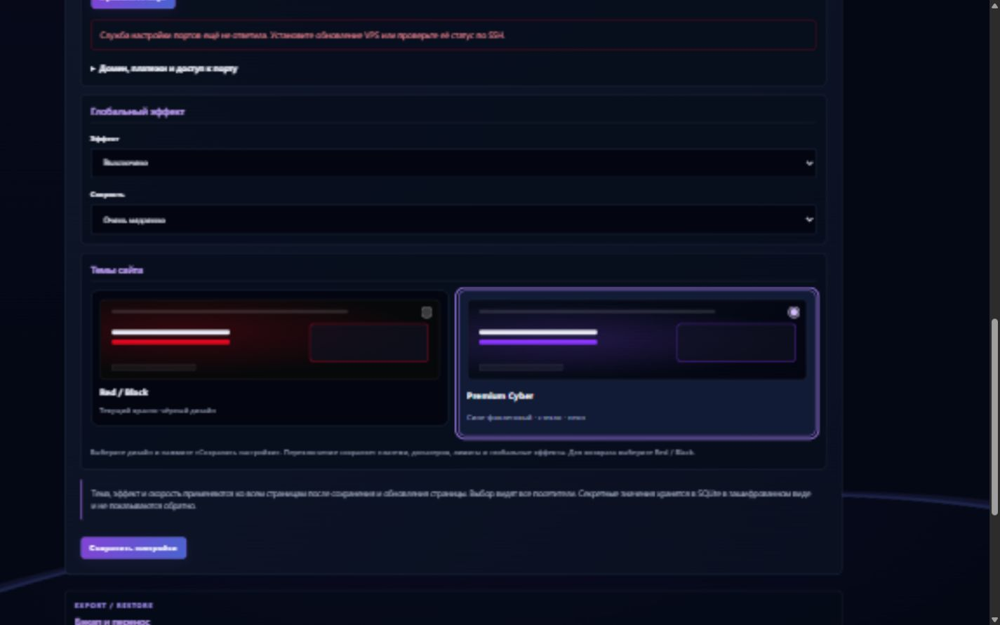

# Две темы сайта

## Как переключить

1. Войдите в `/admin/settings#site-themes`.
2. Под «Глобальным эффектом» найдите раздел «Темы сайта».
3. Выберите **Red / Black** или **Premium Cyber**.
4. Нажмите **Сохранить настройки**. Уже открытые страницы нужно обновить.

Это общий выбор владельца сайта, который видят все посетители и устройства. Перезапуск приложения, редактирование `.env` и изменение Nginx не нужны. При обновлении существующего сайта автоматически остаётся Red / Black. Для возврата из новой темы достаточно снова выбрать Red / Black.

## Что меняется

Red / Black сохраняет существующую вёрстку. У Premium Cyber своя композиция страницы доната: три зоны первого экрана, SVG-иллюстрация ноутбука, стеклянная форма, сине-фиолетовые акценты, карточки донатеров, четыре информационные карточки и футер. Общие страницы и административная часть получают соответствующую палитру.

Обе темы используют одну базу данных, платёжный API, webhook, лимиты, учётные записи, 2FA, reCAPTCHA и push-подписки. Выбор темы не меняет платёжные ключи и реквизиты. Настроенный глобальный эффект продолжает работать вместе с темой.

## Суммы и реальные данные

В Premium Cyber стандартные быстрые суммы — 500, 1000, 2000 и 5000 ₽. Если администратор изменил минимальную или максимальную сумму, варианты подстраиваются под разрешённый диапазон. Можно ввести другую сумму внутри этого диапазона. Никнейм, сообщение и сумма поступают в прежний `/api/payments`.

Отображаются реальные записи донатеров; первые 12 раскрываются сразу, остальные — кнопками «Все донатеры» или «Показать всех». Закреплённые записи получают золотой VIP-акцент. Дата показывается только при наличии в базе. Загрузка личных аватаров в текущей модели данных отсутствует, поэтому вымышленные аватарки не добавлены.

Сейчас создание платежа использует `payment_method_data.type=sbp`. В интерфейсе показан настоящий знак СБП и название ЮKassa. Отдельные неподключённые способы оплаты банков не имитируются.

## Хранение и перенос

`SITE_THEME` хранится в существующей таблице настроек SQLite. Допустимы `classic` и `cyber`; неизвестное значение безопасно возвращает классическую тему. Выбор включён в существующий полный бэкап и восстанавливается вместе с настройками. Отдельные настройки в `.env` не нужны.

Новая тема подключает дополнительные CSS и JS только при выборе `cyber`. Декоративный ноутбук — локальный SVG. Новые внешние библиотеки и отдельные сетевые запросы для декораций не добавлены. Анимации учитывают `prefers-reduced-motion`.

## Предпросмотр

